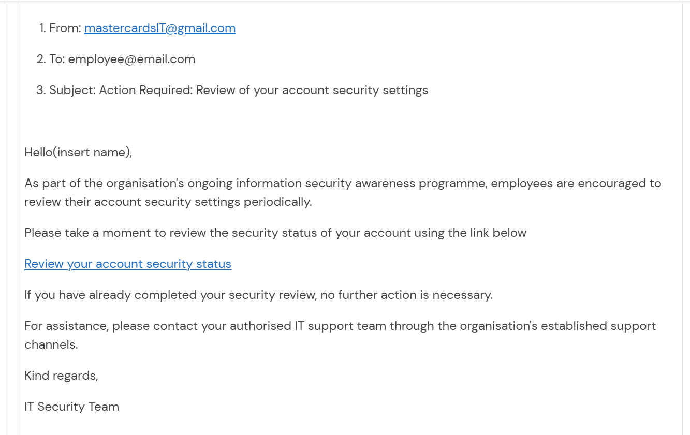

# Phishing Awareness Simulation & Analysis

**Programme:** Mastercard Cybersecurity Job Simulation  
**Platform:** Forage

## Overview
This repository documents a phishing-awareness exercise completed as part of the Mastercard cybersecurity job simulation on Forage. It focuses on understanding phishing, safe hyperlink handling, interpreting simulation outcomes and translating findings into employee guidance.

> This is a training simulation, not a live phishing campaign against real Mastercard employees or a real corporate environment.

## Objectives
- Understand phishing and social engineering risks.
- Review reported simulation outcomes.
- Identify where additional awareness support may be useful.
- Communicate safe hyperlink inspection and suspicious-email reporting.
- Recommend layered technical and organisational controls.

## Repository guide
- * [**01. Project Overview**](docs/project-overview.md) – scope and objectives
- * [**02. methodology**](docs/methodology.md) – method and metric definitions
- * [**03. results and analysis**](docs/results-analysis.md) – reported results and interpretation
- * [**04. recommendations**](docs/recommendations.md) – awareness and technical controls
- * [**View Full Project Presentation Documentation (PDF)**](presentation/Security-awareness-training.pdf) – employee-awareness presentation
-  – redacted simulation screenshots
- * [**certificate earned**](certificates/Phishing-simulation-completion-certificate.pdf) – completion certificate issued

## Limitations
Sample sizes, exact metric definition and statistical methodology are not in the current notes. Treat percentages as descriptive indicators, not proof of departmental security posture.

## Author
**Patricia Stephanie** · [GitHub profile](https://github.com/PatriciaStephanie5)
